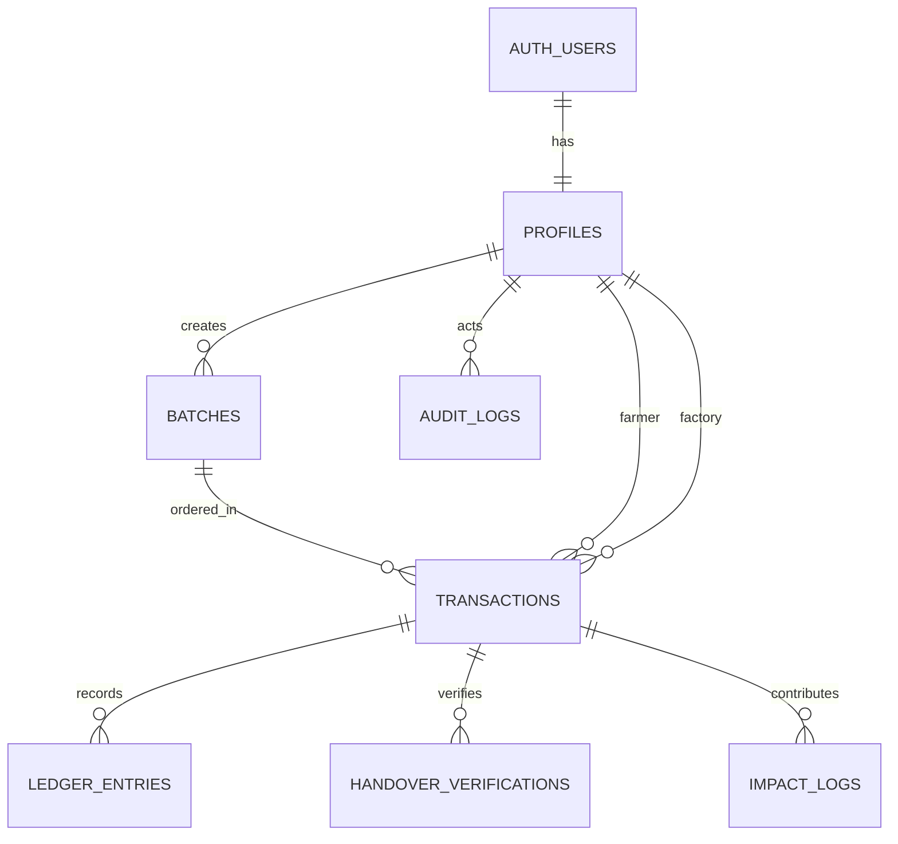

# RE-FLOW Database Design

> Target: Supabase PostgreSQL. Ini skema rancangan awal; sesuaikan migration dengan versi Supabase/PostgreSQL proyek.

## 1. Prinsip

- Primary key menggunakan UUID.
- Timestamp disimpan sebagai `timestamptz` dalam UTC.
- Harga menggunakan integer rupiah, bukan `float`.
- Kuantitas kilogram menggunakan `numeric(12,2)` agar pecahan bisa ditangani jika kebijakan bisnis mengizinkan.
- Status dibatasi dengan `CHECK` atau enum; pilih salah satu pendekatan konsisten.
- `auth.users` dikelola Supabase Auth. Tabel `profiles` menyimpan data aplikasi.
- Jangan mengandalkan frontend untuk integritas stok dan transisi status.
- Gunakan RLS untuk akses client, dan service role hanya di server tepercaya.

## 2. ERD ringkas

## 3. Tables

### `profiles`
Satu baris per akun aplikasi.

| Column | Type | Rules |
|---|---|---|
| `id` | `uuid` | PK, references `auth.users(id)` on delete cascade |
| `name` | `text` | not null |
| `role` | `text` | not null, check in `factory`, `farmer`, `admin` |
| `phone` | `text` | nullable |
| `latitude` | `double precision` | nullable, -90..90 |
| `longitude` | `double precision` | nullable, -180..180 |
| `created_at` | `timestamptz` | not null default now() |
| `updated_at` | `timestamptz` | not null default now() |

Jangan izinkan user mengubah role sendiri melalui update profile biasa. Pembuatan role admin harus melalui proses tepercaya.

### `batches`
Listing ampas tahu dari pabrik.

| Column | Type | Rules |
|---|---|---|
| `id` | `uuid` | PK default `gen_random_uuid()` |
| `factory_id` | `uuid` | FK `profiles(id)` not null |
| `quantity_kg` | `numeric(12,2)` | > 0 |
| `reserved_kg` | `numeric(12,2)` | default 0, >= 0 |
| `sold_kg` | `numeric(12,2)` | default 0, >= 0 |
| `price_per_kg_idr` | `integer` | >= 0 |
| `latitude` | `double precision` | not null, -90..90 |
| `longitude` | `double precision` | not null, -180..180 |
| `prepared_at` | `timestamptz` | not null |
| `expires_at` | `timestamptz` | not null |
| `description` | `text` | nullable |
| `status` | `text` | `available`, `paused`, `sold_out`, `expired`, `cancelled` |
| `created_at` | `timestamptz` | not null default now() |
| `updated_at` | `timestamptz` | not null default now() |

Available quantity dapat dihitung sebagai `quantity_kg - reserved_kg - sold_kg`. Jika kolom `available_kg` disimpan demi performa, harus dijaga oleh transaksi/RPC agar tidak drift. MVP lebih aman menggunakan satu operasi atomik untuk reservasi.

`expires_at` ditentukan server dari `prepared_at` dan aturan umur 12 jam. Jangan menerima `expires_at` bebas dari client.

### `transactions`
Satu pesanan/kontrak pembelian.

| Column | Type | Rules |
|---|---|---|
| `id` | `uuid` | PK |
| `batch_id` | `uuid` | FK `batches(id)` |
| `farmer_id` | `uuid` | FK `profiles(id)` |
| `factory_id` | `uuid` | FK `profiles(id)` |
| `quantity_kg` | `numeric(12,2)` | > 0 |
| `unit_price_idr` | `integer` | snapshot harga saat order |
| `total_amount_idr` | `bigint` | snapshot total |
| `status` | `text` | status machine pada API.md |
| `payment_mode` | `text` | MVP harus `simulation` |
| `idempotency_key` | `text` | not null untuk create order |
| `cancel_reason` | `text` | nullable |
| `created_at` | `timestamptz` | not null default now() |
| `updated_at` | `timestamptz` | not null default now() |
| `completed_at` | `timestamptz` | nullable |

Tambahkan unique constraint pada `(farmer_id, idempotency_key)`. Bila key sama datang lagi dengan payload sama, kembalikan transaksi lama; bila payload berbeda, return conflict. Simpan snapshot harga agar perubahan harga batch tidak mengubah order lama.

### `ledger_entries`
Ledger saldo simulasi yang bersifat append-only.

| Column | Type | Rules |
|---|---|---|
| `id` | `uuid` | PK |
| `transaction_id` | `uuid` | FK `transactions(id)` |
| `account_profile_id` | `uuid` | FK `profiles(id)` |
| `entry_type` | `text` | `payment`, `release`, `refund`, `reversal` |
| `amount_idr` | `bigint` | gunakan konvensi debit/kredit terdokumentasi |
| `status` | `text` | `posted`, `reversed` |
| `reference_key` | `text` | unique untuk mencegah duplikasi |
| `created_at` | `timestamptz` | default now() |

Ini hanya ledger simulasi. Jangan menamai saldo simulasi sebagai uang yang benar-benar dititipkan/ditahan.

### `handover_verifications`
Verifikasi serah-terima dengan PIN satu kali.

| Column | Type | Rules |
|---|---|---|
| `id` | `uuid` | PK |
| `transaction_id` | `uuid` | FK, unique bila hanya satu verifikasi aktif |
| `pin_hash` | `text` | not null, tidak pernah dikirim kembali ke client |
| `expires_at` | `timestamptz` | not null |
| `attempt_count` | `integer` | default 0 |
| `consumed_at` | `timestamptz` | nullable |
| `created_at` | `timestamptz` | default now() |

Jangan simpan PIN plaintext. Jika perlu riwayat penerbitan PIN, pisahkan tabel issuance dan jangan menyimpan nilai PIN.

### `impact_logs`
Snapshot kontribusi dampak yang dapat ditelusuri.

| Column | Type | Rules |
|---|---|---|
| `id` | `uuid` | PK |
| `transaction_id` | `uuid` | FK, unique untuk satu snapshot per transaksi selesai |
| `material_kg` | `numeric(12,2)` | not null |
| `estimated_co2e_kg` | `numeric(14,3)` | not null |
| `estimated_savings_idr` | `bigint` | not null |
| `methodology_version` | `text` | not null |
| `created_at` | `timestamptz` | default now() |

Koefisien harus memiliki versi dan label estimasi. Hindari menghitung impact dari transaksi belum selesai.

### `audit_logs`
Catatan aksi penting untuk keamanan dan troubleshooting.

| Column | Type | Rules |
|---|---|---|
| `id` | `uuid` | PK |
| `actor_profile_id` | `uuid` | nullable FK `profiles(id)` |
| `action` | `text` | not null |
| `entity_type` | `text` | not null |
| `entity_id` | `uuid` | nullable |
| `metadata` | `jsonb` | tanpa secret, PIN, token, atau data sensitif |
| `created_at` | `timestamptz` | default now() |

### `idempotency_records` (opsional)
Jika tidak ingin menyimpan key di `transactions`, buat tabel terpisah dengan `actor_id`, `key`, `request_hash`, `response_reference`, dan `created_at`. Gunakan unique constraint `(actor_id, key)`.

## 4. Indexes

- `batches(factory_id, created_at desc)`
- `batches(status, expires_at)`
- `transactions(farmer_id, created_at desc)`
- `transactions(factory_id, created_at desc)`
- `transactions(status, created_at desc)`
- `ledger_entries(transaction_id, created_at)`
- `audit_logs(created_at desc)`
- `impact_logs(created_at desc)`

Untuk pencarian radius yang lebih serius, pertimbangkan PostGIS geography index. Jika tetap menggunakan Haversine di MVP, batasi kandidat melalui query yang sesuai dan hitung jarak di server.

## 5. Transactional stock reservation

Operasi membuat order wajib atomik:
1. Kunci baris batch atau gunakan SQL conditional update.
2. Validasi status batch dan `expires_at > now()`.
3. Pastikan available quantity >= requested quantity.
4. Buat transaksi dengan snapshot harga.
5. Tambah reserved quantity (atau kurangi available quantity) dalam operasi yang sama.
6. Commit; bila salah satu langkah gagal, rollback semua.

Jangan melakukan pola “baca stok → hitung di JavaScript → tulis order” tanpa locking/conditional update, karena dua pembeli dapat memesan stok yang sama.

## 6. Freshness policy

Aturan rancangan:
- 0–8 jam: `green`
- >8–10.5 jam: `yellow`
- 10.5–12 jam: perlu keputusan produk eksplisit, misalnya tetap tampil dengan peringatan; jangan mengarang aturan diskon.
- 12 jam atau lebih: hapus dari katalog ampas segar dan tandai `expired`; alur maggot/kasgot adalah fase lanjutan.

Semua waktu dihitung dari `prepared_at`, bukan waktu listing dibuat. Backend menentukan zona berdasarkan jam server.

## 7. RLS direction

- `profiles`: user dapat membaca/mengubah field profil yang diizinkan miliknya sendiri; role dilindungi.
- `batches`: publik terautentikasi dapat membaca listing eligible; factory hanya mengubah miliknya.
- `transactions`: farmer/factory hanya melihat transaksi yang terkait dengannya; admin melalui policy khusus.
- `ledger_entries`, `handover_verifications`, `audit_logs`: jangan memberi akses tulis langsung dari client. Gunakan server/RPC yang memeriksa otorisasi.
- `impact_logs`: baca agregat sesuai kebijakan; tidak boleh ditulis bebas oleh client.

Tuliskan dan uji policy RLS secara eksplisit sebelum deploy.
