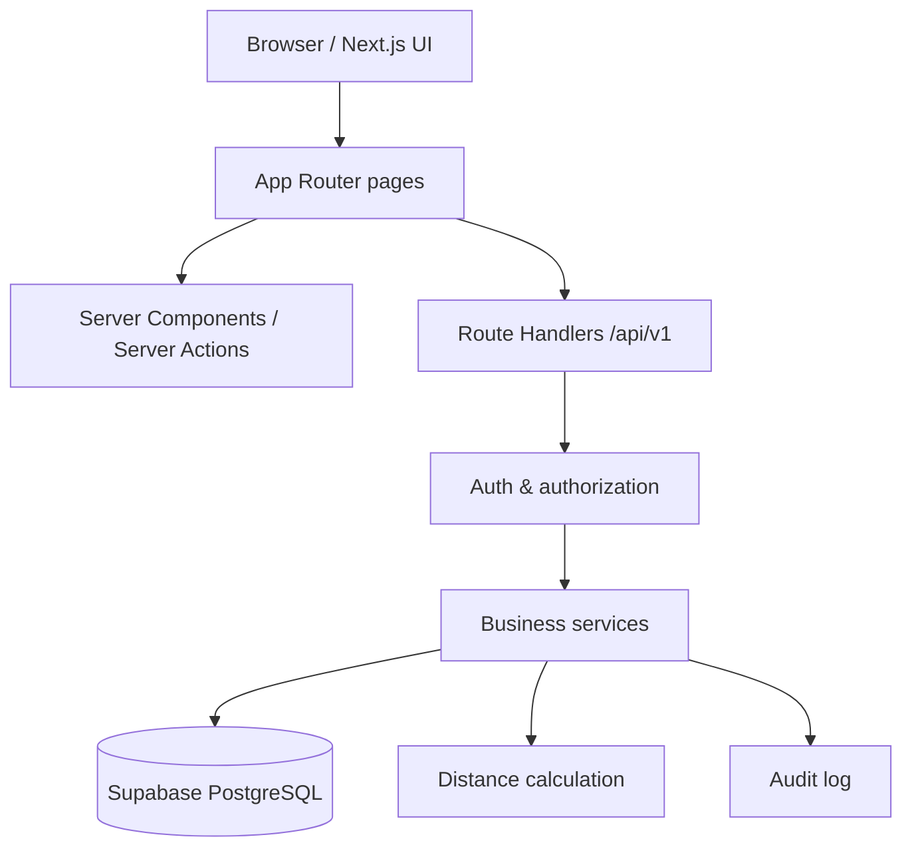

# RE-FLOW System Architecture

## 1. Tujuan

MVP menghubungkan pabrik tahu sebagai pemasok dengan peternak sebagai pembeli ampas tahu melalui listing lokal, status kesegaran, pemesanan, pembayaran simulasi, dan konfirmasi serah-terima.

## 2. Stack dan batasan

- Next.js 14 App Router + TypeScript
- Tailwind CSS
- Supabase Auth + PostgreSQL
- Leaflet.js + OpenStreetMap untuk peta
- Route Handlers di `app/api`
- Business logic di server-side service layer
- Pembayaran hanya simulasi

## 3. Arsitektur logis



Frontend tidak boleh menjadi sumber kebenaran untuk harga, stok, jarak, kesegaran, status, dan hak akses. Server memvalidasi ulang semua input.

## 4. Suggested folder structure

```text
src/
  app/
    (public)/
      page.tsx
      marketplace/page.tsx
      batches/[batchId]/page.tsx
    (auth)/
      login/page.tsx
      register/page.tsx
    (dashboard)/
      farmer/page.tsx
      factory/page.tsx
      transactions/page.tsx
      transactions/[transactionId]/page.tsx
      impact/page.tsx
    api/
      v1/
        me/route.ts
        batches/route.ts
        batches/[batchId]/route.ts
        transactions/route.ts
        transactions/[transactionId]/route.ts
        transactions/[transactionId]/pay-simulation/route.ts
        transactions/[transactionId]/mark-shipped/route.ts
        transactions/[transactionId]/confirm-received/route.ts
        transactions/[transactionId]/verify-pin/route.ts
        impact/summary/route.ts
  components/
    ui/
    layout/
    map/
    batches/
    transactions/
  lib/
    supabase/
      browser.ts
      server.ts
      admin.ts
    auth/
      require-user.ts
      require-role.ts
    validation/
      batch.schema.ts
      transaction.schema.ts
    services/
      batch.service.ts
      transaction.service.ts
      payment-simulation.service.ts
      handover.service.ts
      impact.service.ts
    repositories/
      batch.repository.ts
      transaction.repository.ts
    geo/
      haversine.ts
    freshness/
      freshness.ts
    errors/
      api-error.ts
    audit/
      audit.service.ts
  types/
    database.ts
    api.ts
supabase/
  migrations/
  seed.sql
tests/
  unit/
  integration/
  e2e/
```

Struktur ini usulan. Bila repository awal berbeda, adaptasi secara konsisten tanpa menaruh semua logic dalam satu file.

## 5. Responsibility boundaries

- **UI/components:** menampilkan data dan mengirim aksi pengguna; tidak memutuskan final status transaksi.
- **Route handlers:** parse request, autentikasi, validasi, memanggil service, mengembalikan HTTP response.
- **Services:** aturan bisnis, state transitions, freshness, pembayaran simulasi, stok, impact.
- **Repositories:** query database terpusat dan bertipe.
- **Supabase RLS:** lapisan tambahan, bukan pengganti pemeriksaan authorization di service.
- **Database functions/RPC:** operasi atomik kritis seperti reservasi stok, consume PIN, atau refund idempotent.
- **Audit service:** mencatat aksi sensitif tanpa secret.

## 6. Auth and role flow

1. User mendaftar/login menggunakan Supabase Auth.
2. Server membaca user dari sesi yang tervalidasi.
3. Server mengambil profil dari `profiles`.
4. Server mengecek role dan kepemilikan resource.
5. Route handler memanggil service.
6. Service melakukan perubahan melalui Supabase server client/RPC dengan hak akses paling kecil.
7. UI menerima data yang sudah diizinkan.

Jangan menerima `user_id`, `role`, atau `factory_id` dari client sebagai bukti identitas. Ambil actor ID dari sesi.

## 7. Core business flows

### Create batch
- Factory login.
- Server validasi quantity, price, coordinate, dan `prepared_at`.
- Server menghitung `expires_at` dan freshness zone.
- Batch dibuat `available` jika belum expired dan quantity positif.
- Semua nilai turunan dihitung server.

### Browse marketplace
- Server menentukan titik lokasi dari query yang tervalidasi atau profil.
- Batasi radius maksimal 15 km untuk MVP.
- Hitung jarak menggunakan Haversine di server.
- Filter batch yang eligible dan belum expired.
- Frontend menampilkan jarak/zona yang dikirim server.
- Peta Leaflet memakai OpenStreetMap; jangan mengirim secret key (jika kelak ada) ke client.

### Create transaction
- Farmer membuat request dengan batch dan quantity.
- Server memeriksa role, freshness, status, stok, dan idempotency key.
- Database melakukan reservasi dan pembuatan transaksi secara atomik.
- Total dihitung dari snapshot harga di database.
- Status awal `awaiting_simulated_payment`.

### Simulated payment and handover
- Farmer menjalankan pembayaran simulasi.
- Ledger simulasi mencatat aksi secara idempotent.
- Factory menandai dikirim.
- Farmer mengonfirmasi penerimaan.
- PIN one-time diverifikasi server; sukses menyelesaikan transaksi sesuai state machine.
- Jangan mengklaim uang nyata dipindahkan atau disimpan.

### Expiry
- Backend memfilter batch expired pada setiap read kritis.
- Cron/scheduled job boleh menandai status secara periodik, tetapi keselamatan tidak boleh bergantung hanya pada cron.
- Saat create order, server tetap memeriksa `expires_at > now()`.
- Batch >=12 jam tidak boleh dibeli sebagai pakan segar.

## 8. Freshness & distance utilities

### Haversine
- Input: lat/lng batch dan lat/lng titik pencarian.
- Validasi latitude [-90, 90], longitude [-180, 180].
- Output kilometer dibulatkan untuk tampilan saja; perbandingan radius memakai nilai presisi penuh.
- Radius MVP maksimum 15 km.

### Freshness
- `ageHours = (serverNow - preparedAt) / 3_600_000`
- `green`: 0–8 jam
- `yellow`: >8–10.5 jam
- 10.5–12 jam: tunggu keputusan produk eksplisit.
- >=12 jam: expired dari katalog segar.
- Tolak `prepared_at` di masa depan.

## 9. Error handling

Buat error domain yang dipetakan ke HTTP status dan error code dari API.md. Jangan kirim stack trace, SQL, token, atau detail internal ke client. Log server menyertakan correlation/request ID, bukan secret.

## 10. Environment variables

Contoh nama:
```env
NEXT_PUBLIC_SUPABASE_URL=
NEXT_PUBLIC_SUPABASE_ANON_KEY=
SUPABASE_SERVICE_ROLE_KEY=
```

- Service role hanya di environment server, tidak boleh memakai prefix `NEXT_PUBLIC_`.
- Jangan commit `.env.local`.
- Validasi env saat startup/build.
- Untuk produksi, gunakan secrets manager/setting environment hosting.

## 11. Non-MVP / future expansion

Pisahkan di modul dan jangan tampilkan seolah sudah live:
- Payment gateway / SNAP BI / Open API.
- KUR atau kemitraan perbankan.
- QR/barcode segel fisik anti-rusak.
- Clearinghouse BSF maggot dan kasgot.
- Integrasi logistik atau verifikasi pihak ketiga.

Implementasi fase lanjutan memerlukan partner, kebijakan, dan spesifikasi keamanan tersendiri.
